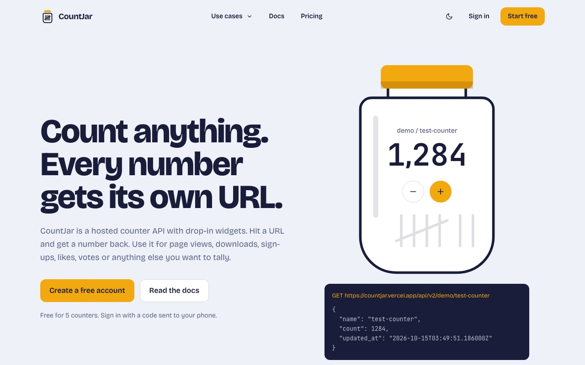
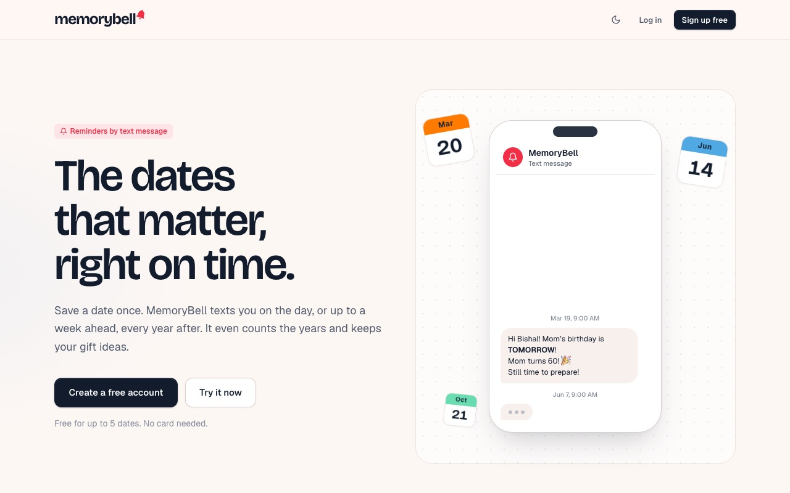
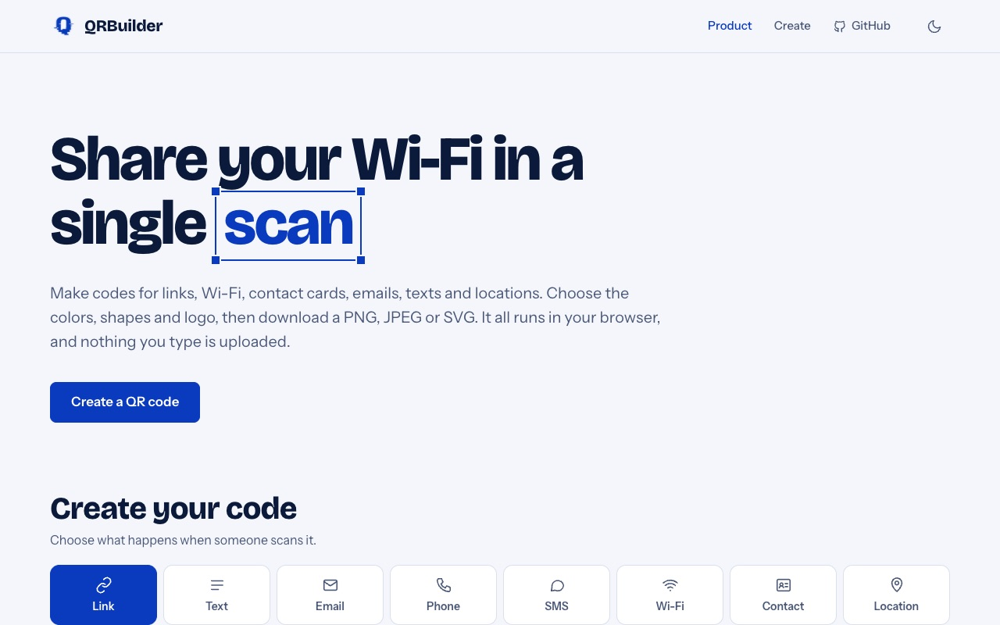
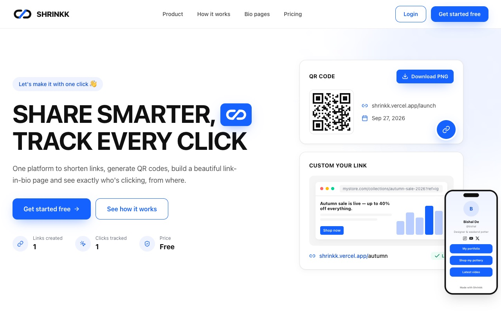
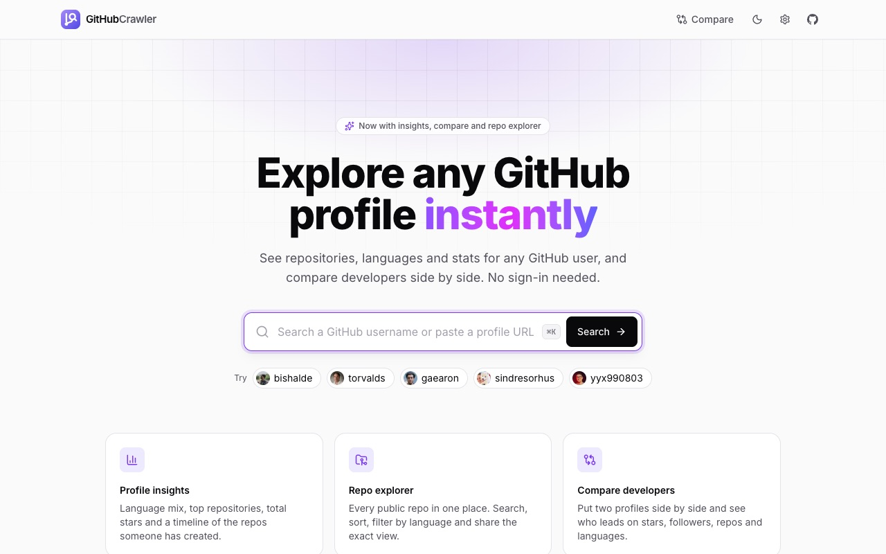
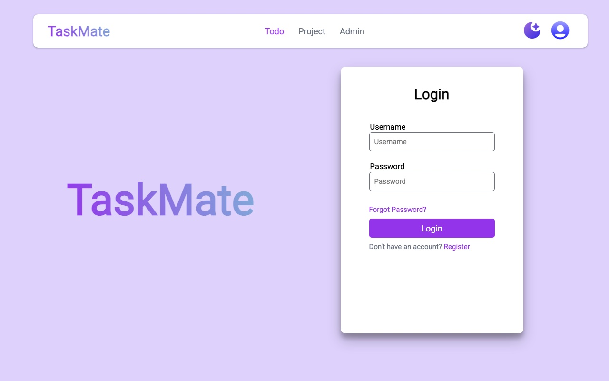

# Hi, I'm Bishal De 👋

**Software Development Engineer @ Twilio** · Full-stack · ML and Gen-AI · DevOps and observability

📍 Bengaluru, India

## About me

I build the systems that keep distributed communications infrastructure reliable on
**Twilio's Observability team**. Over 3+ years I've worked across the whole stack:
React and Next.js frontends, Python and Go services, ML and LLM systems, and the AWS,
Docker and Kubernetes infrastructure underneath.

- 🔭 Building observability tooling in Python and Go at **Twilio**
- 🛠️ Shipping small, useful web apps in my spare time, like **[CountJar](https://countjar.vercel.app)**
- 🧠 Interested in RAG, LLM applications and platform engineering
- 🏆 3× hackathon podium finisher, with two 1st places
- 💼 Open to freelance work and collaborations

## Things I've built

<table>
  <tr>
    <td width="50%" valign="top">
      
      <h3><a href="https://countjar.vercel.app">CountJar</a></h3>
      Hosted counters where every number gets its own URL. Count views, likes, votes and ratings over an API, show them with widgets and badges, and get milestone alerts. The views badge above runs on it.
        <code>Flask</code> <code>MongoDB</code> <code>Tailwind</code> <code>Twilio Verify</code> · <a href="https://github.com/bishalde/countjar">Code</a>
    </td>
    <td width="50%" valign="top">
      
      <h3><a href="https://memorybell.vercel.app">MemoryBell</a></h3>
      Save a birthday or anniversary once and get a text on the day, or up to a week ahead, every year. Counts the years and keeps your gift ideas.
        <code>Flask</code> <code>MongoDB</code> <code>Twilio</code> <code>Tailwind</code> · <a href="https://github.com/bishalde/MemoryBell">Code</a>
    </td>
  </tr>
  <tr>
    <td width="50%" valign="top">
      
      <h3><a href="https://qrbuilder.vercel.app">QRBuilder</a></h3>
      QR codes for links, Wi-Fi, contact cards, emails, texts and locations, with custom colours, shapes and logos. Exports PNG, JPEG or SVG, all in the browser.
        <code>JavaScript</code> <code>Privacy-first</code> · <a href="https://github.com/bishalde/QR-Code-Generator">Code</a>
    </td>
    <td width="50%" valign="top">
      
      <h3><a href="https://shrinkk.vercel.app">Shrinkk</a></h3>
      Shorten links, generate QR codes and build a link-in-bio page, then see who's clicking and from where.
        <code>Django</code> <code>Analytics</code> · <a href="https://github.com/bishalde/Shrinkk">Code</a>
    </td>
  </tr>
  <tr>
    <td width="50%" valign="top">
      
      <h3><a href="https://githubcrawler.vercel.app">GitHubCrawler</a></h3>
      Explore any GitHub profile: language mix, top repos, total stars and a repo timeline, plus side-by-side developer comparison. No sign-in needed.
        <code>GitHub API</code> <code>Analytics</code> · <a href="https://github.com/bishalde/GithubCrawler">Code</a>
    </td>
    <td width="50%" valign="top">
      
      <h3><a href="https://taskmatee.vercel.app">TaskMate</a></h3>
      A to-do and project manager for creating, organising and prioritising tasks, with an admin view.
        <code>Django</code> <code>MongoDB</code> · <a href="https://github.com/bishalde/TaskMate">Code</a>
    </td>
  </tr>
</table>

More on my [portfolio](https://bishalde.vercel.app/#projects) and in my [repositories](https://github.com/bishalde?tab=repositories).

## Tech stack

**Languages** 

**Frontend** 

**Backend and data** 

**Cloud, DevOps and observability** 

Also: ClickHouse · Datadog · OpenTelemetry · Buildkite · LLMs and RAG · React Native

## Experience

| When | Role |
| --- | --- |
| **Jun 2025 – now** | **Software Development Engineer, [Twilio](https://www.twilio.com)**: observability for the Communications business unit, in Python and Go, with Datadog, Grafana, Prometheus, Buildkite and AWS |
| Aug 2024 – May 2025 | **Software Developer Intern, Nokia**: full-stack apps with Next.js, Express and Flask, Docker and Kubernetes deployments, RAG and LLM features |
| Jan 2024 – Jul 2024 | **Cloud & Digital Analytics Intern, PwC**: Python, data engineering and analytics |
| Oct 2023 – Dec 2023 | **Full Stack Developer Intern, Reflow Technologies**: client websites with Next.js, Firebase, MongoDB and MQTT |

**Education:** B.Tech in Computer Science (AI & ML), SRM Institute of Science & Technology, 2021 – 2025, CGPA 9.76

**Hackathons:** 🥇 M2P Hackathon (2023) · 🥇 Bajaj Finserv Appathon (2024) · 🥈 Synapse Hackathon (2024)

## GitHub stats

<picture>
  <source media="(prefers-color-scheme: dark)" srcset="https://github-readme-stats.vercel.app/api?username=bishalde&show_icons=true&hide_border=true&disable_animations=true&theme=github_dark&bg_color=00000000">
  
</picture>
<picture>
  <source media="(prefers-color-scheme: dark)" srcset="https://github-readme-stats.vercel.app/api/top-langs/?username=bishalde&layout=compact&hide_border=true&disable_animations=true&theme=github_dark&bg_color=00000000">
  
</picture>

<picture>
  <source media="(prefers-color-scheme: dark)" srcset="https://streak-stats.demolab.com/?user=bishalde&hide_border=true&disable_animations=true&theme=github-dark-blue&background=00000000">
  
</picture>

## Elsewhere

Got a product to ship, a system to scale or an AI idea to prototype? Say hi at
**[itsbishalde@yahoo.com](mailto:itsbishalde@yahoo.com)**.
